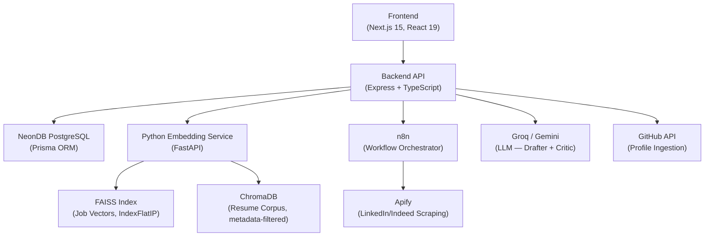

# PlaceMates 🎯

**AI-Powered Job Hunting Companion with Multi-Agent RAG Resume Generation**

[](https://nodejs.org/)
[](https://nextjs.org/)
[](https://www.typescriptlang.org/)
[](https://fastapi.tiangolo.com/)
[](https://www.prisma.io/)
[](http://makeapullrequest.com)

---

PlaceMates doesn't just help you find jobs — it **understands your career** at a semantic level and writes tailored, ATS-optimized resumes for every application automatically.

The system ingests your professional identity from GitHub and LinkedIn, converts it into a 384-dimensional dense vector using `SentenceTransformers`, matches it against daily-scraped job listings via FAISS cosine similarity, and then deploys a **3-agent Constitutional AI loop** (Retriever → Drafter → Critic) to generate bespoke resumes that must pass a 75/100 ATS quality gate before reaching you.

Every resume that scores **90+** gets recycled into the retrieval corpus — making the system smarter with every generation.

---

## Table of Contents

- [How It Works](#-how-it-works)
- [Architecture](#-architecture)
- [Key Features](#-key-features)
- [Tech Stack](#-tech-stack)
- [Project Structure](#-project-structure)
- [Getting Started](#-getting-started)
- [Environment Variables](#-environment-variables)
- [Screenshots](#-screenshots)
- [Future Roadmap](#-future-roadmap)
- [Contributing](#-contributing)

---

## 🔄 How It Works

### 1. Data Ingestion — "Proof of Work, Not Claims"

Your professional identity is scattered across platforms. PlaceMates converges it:

**GitHub Pipeline** (fully offline — zero LLM calls):
```
GitHub API → Fetch ALL repos → Per-repo analysis → Composite score → Select top 10
  └→ languages + contributors + readme + user commits
       └→ readmeAnalyzer   (regex/rule-based README parsing)
       └→ commitAnalyzer   (commit message NLP patterns)
       └→ fileAnalyzer     (file path → module/feature detection)
       └→ domainDetector   (multi-signal domain inference)
            └→ generateProjectBullets (template engine)
                 └→ Upsert Projects + Skills + UserSummary
```

Each repo is scored using a **7-signal composite ranking formula**:
| Signal | Weight | What It Captures |
|:---|:---|:---|
| Commit count | 30% | Direct evidence of work |
| Quality score | 20% | Stars + forks + README presence |
| Feature score | 20% | Detected features from all analyzers |
| README presence | 10% | Binary documentation signal |
| Recency | 10% | Exponential decay over 365 days |
| Complexity | 10% | Language count + full-stack bonus + DB signals |
| Contribution type | 10% | Solo vs. collaborative work |

Only meaningful repos survive (empty repos, uncontributed forks, and zero-data repos are filtered out).

**LinkedIn Pipeline**: Upload your LinkedIn data export (`.zip`) → CSV parsing of Positions, Skills, Education, Honors, Certifications → Rule-based formatting → Skill merging with GitHub data using source-aware deduplication (`"github"` + `"linkedin"` → `"both"`).

**Optional LLM Enrichment**: A single Gemini/Groq call enriches up to 6 projects with AI descriptions, complexity scores, and unique angles. This never overwrites offline data — it only adds to it.

### 2. Profile Vectorization — "Translating You Into Math"

Your entire enriched profile is flattened into a single text string with **priority ordering** (Domain first → Skills → Experience → Projects → Education → Certifications), then passed to a Python microservice:

```python
model.encode(text, convert_to_numpy=True, normalize_embeddings=True)
# Model: all-MiniLM-L6-v2 (22M params, 384-dim output)
# L2-normalized → cosine similarity = dot product
```

An MD5 hash of the flattened text enables **cache invalidation** — profiles are only re-embedded when data actually changes.

### 3. Job Scraping — "The Daily Grind"

A 3-tier automated pipeline runs daily:

```
Apify (scrapes LinkedIn/Indeed) → n8n (orchestrates workflow) → Express API (persists + embeds)
```

- **Apify** handles browser automation, proxy rotation, and CAPTCHA solving
- **n8n** chains the scraping → embedding → matching → resume generation workflow
- Jobs are deduplicated by URL using idempotent upserts (`ON CONFLICT DO NOTHING`)
- Each scraped job description is immediately vectorized and added to the FAISS index

### 4. Semantic Matching — "Beyond Keywords"

```
FAISS search (top 100, threshold 0.35) → PostgreSQL post-filter (24h + location) → Top 5
```

This is a **2-stage retrieval pipeline** (the same pattern Google uses):
- **Stage 1 (FAISS)**: High recall, low precision — 100 candidates using `IndexFlatIP` (sub-ms on 100K vectors)
- **Stage 2 (SQL)**: Business logic filters — recency, location preferences
- **Stage 3 (Sort)**: Re-rank by cosine similarity score → final 5 matches

The threshold of **0.35** is intentionally low. "MERN stack" and "React/Node JS" map to similar vector regions even without keyword overlap — that's the entire point of semantic search.

### 5. Multi-Agent RAG Resume Generation — "The Magic"

For each of your top 5 job matches, a **Constitutional AI pipeline** generates a tailored resume:

```
┌──────────────────────────────┐
│       Retriever Agent         │
│  (ChromaDB + PostgreSQL)      │  → 3 base + 2 generated = 5 examples
└──────────┬───────────────────┘
           │
           ▼
┌───────────────────────────────────────────────────────┐
│                  RAG Orchestrator                       │
│                                                        │
│   for iteration = 1 to 3:                              │
│     ┌────────────┐         ┌────────────┐             │
│     │   Drafter   │ ──────→│   Critic    │             │
│     │  (t=0.4)   │        │  (t=0.2)   │             │
│     └────────────┘         └─────┬──────┘             │
│           ▲                      │                     │
│           │   if ATS < 75:       │                     │
│           │   feedback ──────────┘                     │
│           │   if ATS ≥ 75: APPROVE & BREAK            │
│           └───────────────────────────────            │
└───────────────────────────────────────────────────────┘
```

- **Retriever**: Pulls 3 curated "gold-standard" examples from ChromaDB + 2 high-scoring generated resumes from PostgreSQL (blended retrieval with experience replay)
- **Drafter** (temperature 0.4): Rewrites your profile using the JD + RAG examples. Action verbs, quantified metrics, keyword mirroring — all enforced via prompt engineering
- **Critic** (temperature 0.2): Scores on 5 ATS criteria (Keyword Coverage, Quantification, Action Verbs, Section Completeness, Relevance) — 20 points each, total 100. Has a **heuristic fallback** if the LLM fails
- **Convergence**: The loop runs max 3 iterations. The system tracks `bestResume` across iterations, so even if iteration 3 fails, the highest-scoring draft is always returned

### 6. Self-Improving Dataset — "The Flywheel"

Resumes scoring **≥ 90** (not 75 — this is deliberately higher to prevent a "positive feedback loop of mediocrity") are stored back into the retrieval corpus, but only if they pass a **diversity gate** (cosine similarity < 0.9 with ALL existing entries). This prevents dataset collapse while letting the system learn from its best work over time.

---

## 🏗 Architecture



### Why Two Languages?

This is **not optional polyglotism**. FAISS, SentenceTransformers, and ChromaDB are Python-only libraries with no production-quality Node.js equivalents. The TypeScript backend handles business logic, auth, and LLM orchestration; the Python service handles all vector math.

| Concern | Node.js Backend | Python Embedding Service |
|:---|:---|:---|
| Owns | Auth, API routing, Prisma ORM, LLM agent orchestration | Vector embedding, FAISS index, ChromaDB, similarity search |
| Communication | HTTP client with circuit breaker (5 failures → 60s cooldown) | FastAPI endpoints |

### Database Design

PostgreSQL schema across 7 entity groups:
1. **Identity**: `UserAuth`, `UserProfile`, `OAuthAccount`
2. **GitHub output**: `GithubRepository` (with analysis fields, LOC, domain detection, scoring)
3. **LinkedIn output**: `LinkedInData`, `LinkedinInsight`, `LinkedinSkillInsight`
4. **Merged/computed**: `UserSkillInsight`, `UserDashboardInsight`, `UserPortfolio`
5. **Job matching**: `JobDescriptionInsight`
6. **Portfolio**: `UserPortfolio` (with unique `portfolioSlug`)
7. **Resume comparison**: Score-based resume analysis and tracking

---

## ✨ Key Features

| Feature | What It Does | Why It's Not Generic |
|:---|:---|:---|
| **Offline-First GitHub Analysis** | Rule-based repo analysis — readmeAnalyzer, commitAnalyzer, fileAnalyzer, domainDetector | Zero LLM cost, deterministic, privacy-preserving. No user code leaves your server. |
| **7-Signal Composite Scoring** | Weighted formula combining commits, quality, features, recency, complexity, contribution type | Surfaces meaningful projects, not "hello-world" repos |
| **Semantic Job Matching** | 384-dim embeddings + FAISS `IndexFlatIP` + SQL post-filtering | "React developer" matches "Frontend Engineer" without keyword overlap |
| **Constitutional AI Resume Loop** | Retriever → Drafter → Critic with iterative refinement (max 3 rounds) | Separation of generation and evaluation prevents self-validation bias |
| **Self-Improving RAG Corpus** | Score ≥ 90 + diversity ≥ 0.9 gate | Prevents dataset collapse, implements experience replay from RL |
| **Blended Retrieval** | 3 curated + 2 generated examples | Static corpus anchors quality; generated corpus adds personalization |
| **Skill Source Tracking** | Skills tagged as `"github"`, `"linkedin"`, or `"both"` | Cross-platform verification — claimed vs. demonstrated competency |
| **Portfolio Studio** | Auto-generated public developer portfolio from enriched profile | Zero-effort public presence from existing data |
| **Circuit Breaker Pattern** | Embedding client: 5 consecutive failures → 60s open circuit → half-open probe | Production-grade resilience for the Python microservice |
| **Graceful Degradation** | Every layer has a fallback: LLM → heuristic, ChromaDB → zero-shot, LinkedIn → GitHub-only | The system **never** completely fails |

---

## 🛠 Tech Stack

**Frontend**
| Technology | Purpose |
|:---|:---|
| Next.js 15 (App Router) | Server-rendered React framework |
| React 19 | UI library |
| Tailwind CSS v4 | Utility-first styling |
| Radix UI | Accessible, unstyled component primitives |
| Recharts | Data visualization (dashboard analytics) |
| Sonner | Toast notifications |
| React Hook Form | Form state management |

**Backend**
| Technology | Purpose |
|:---|:---|
| Express.js | HTTP API server |
| TypeScript | Type-safe backend |
| Prisma ORM | Type-safe database access, auto-generated types from schema |
| NeonDB (PostgreSQL) | Serverless Postgres — identity, jobs, resumes, embeddings |
| Passport.js | OAuth (GitHub + Google) |
| JSON Web Tokens | Session-less auth |

**AI & ML**
| Technology | Purpose |
|:---|:---|
| SentenceTransformers (`all-MiniLM-L6-v2`) | 384-dim text embedding, ~14K sentences/sec on CPU |
| FAISS (`IndexFlatIP`) | Sub-ms vector similarity search |
| ChromaDB | Metadata-filtered vector store for resume corpus |
| Groq / Gemini | LLM for Drafter + Critic agents |

**Infrastructure**
| Technology | Purpose |
|:---|:---|
| n8n | Visual workflow orchestration (scraping → matching → resume gen) |
| Apify | LinkedIn/Indeed job scraping with proxy rotation |
| node-cron | Daily scheduler (02:00 IST) |

---

## 📁 Project Structure

```
PlaceMates/
├── frontend/                    # Next.js 15 application
│   └── src/
│       └── app/
│           ├── page.tsx                # Landing page
│           ├── dashboard/              # Main user dashboard
│           ├── connect-accounts/       # GitHub + LinkedIn OAuth
│           ├── github-repos/           # Analyzed repos view
│           ├── resume-builder/         # Resume generation UI
│           ├── portfolio-setup/        # Portfolio configuration
│           ├── get-started/            # Onboarding flow
│           └── [slug]/                 # Public portfolio pages
│
├── backend/                     # Express.js API server
│   ├── prisma/
│   │   └── schema.prisma              # PostgreSQL schema (15+ models)
│   └── src/
│       ├── routes/                     # API route definitions
│       │   ├── auth.ts                 # OAuth flow (GitHub + Google)
│       │   ├── github.ts              # GitHub sync + analysis triggers
│       │   ├── linkedin.ts            # LinkedIn ZIP upload + processing
│       │   ├── resumeRoutes.ts        # Resume generation + comparison
│       │   └── portfolioRoutes.ts     # Portfolio CRUD
│       ├── services/                   # Core business logic
│       │   ├── githubAnalysisService.ts    # Offline repo analysis pipeline
│       │   ├── githubActivityService.ts    # GitHub activity tracking
│       │   ├── geminiService.ts            # LLM enrichment (Gemini/Groq)
│       │   ├── scoringService.ts           # Composite ranking formula
│       │   ├── resumeComparisonService.ts  # Resume diff + ATS comparison
│       │   └── skillInsightsService.ts     # Skill analytics
│       ├── controllers/               # Request handlers
│       ├── middleware/                 # Auth, validation
│       └── config/                    # Environment, constants
│
└── package.json                 # Monorepo root (concurrently runs both)
```

---

## 🚀 Getting Started

### Prerequisites

- **Node.js** v20+
- **Python** 3.9+ (for the embedding service — FAISS, SentenceTransformers, ChromaDB)
- **PostgreSQL** (NeonDB recommended for serverless)
- API Keys: GitHub OAuth, Google OAuth, Gemini/Groq, Apify (optional)

### Installation

```bash
# Clone the repository
git clone https://github.com/omi3107/PlaceMates.git
cd PlaceMates

# Install dependencies for both frontend and backend
npm run install:all
```

### Database Setup

```bash
# Generate Prisma client
npm run prisma:generate --prefix backend

# Push schema to your PostgreSQL instance
npm run prisma:push --prefix backend

# (Optional) Open Prisma Studio to inspect data
npm run prisma:studio --prefix backend
```

### Run the Application

```bash
# Start both frontend (port 3000) and backend (port 5000) concurrently
npm run dev
```

---

## 🔐 Environment Variables

Create a `backend/.env` file from the provided example:

```bash
cp backend/.env.example backend/.env
```

| Variable | Required | Description |
|:---|:---|:---|
| `DATABASE_URL` | ✅ | NeonDB PostgreSQL connection string |
| `JWT_SECRET` | ✅ | Secret for signing auth tokens |
| `FRONTEND_URL` | ✅ | Frontend origin (default: `http://localhost:3000`) |
| `GOOGLE_CLIENT_ID` | ✅ | Google OAuth 2.0 client ID |
| `GOOGLE_CLIENT_SECRET` | ✅ | Google OAuth 2.0 secret |
| `GITHUB_CLIENT_ID` | ✅ | GitHub OAuth App client ID |
| `GITHUB_CLIENT_SECRET` | ✅ | GitHub OAuth App secret |
| `TOKEN_ENCRYPTION_KEY` | ✅ | 32-byte hex key for encrypting stored tokens |
| `GEMINI_API_KEY` | ✅ | Google Gemini API key (profile enrichment + agents) |
| `APIFY_API_TOKEN` | ❌ | Apify token (only needed for automated job scraping) |

---

## 📸 Screenshots

| | |
|:---:|:---:|
|  |  |
| *User Dashboard — Skills, domain breakdown, top projects* | *GitHub Repo Analysis — 7-signal scoring, detected domains* |
|  |  |
| *Semantic Job Matches — Cosine similarity scores, AI badge* | *Multi-Agent Resume Builder — Drafter/Critic loop in action* |
|  |  |
| *Auto-Generated Portfolio — Public-facing developer profile* | *Account Linking — GitHub OAuth + LinkedIn data import* |

---

## 🗺 Future Roadmap

Based on current system limitations documented in the architecture overview:

- [ ] **User Feedback Loop** — Let users rate matches (👍/👎) to compute real Precision/Recall and tune the similarity threshold
- [ ] **Queue-Based Architecture** — Replace n8n sequential processing with BullMQ for parallel resume generation
- [ ] **Cover Letter Generation** — Natural extension of the RAG pipeline
- [ ] **Application Tracking** — Track job status (applied → interview → offer) end-to-end
- [ ] **Geocoded Location Matching** — Replace string-based `contains` filter with proper geocoding
- [ ] **Multilingual Embedding Model** — Swap `all-MiniLM-L6-v2` for a multilingual model to support non-English profiles
- [ ] **Real ATS Validation** — Integrate with Jobscan or similar API to validate resumes against actual ATS parsers
- [ ] **Portfolio Hosting** — Deploy generated portfolios to a public CDN

---

## 🤝 Contributing

Contributions are welcome. Whether it's improving the RAG pipeline, adding a new data ingestion source, or refining the frontend:

1. Fork the repo
2. Create your branch: `git checkout -b feature/your-feature`
3. Commit changes: `git commit -m "feat: add your feature"`
4. Push: `git push origin feature/your-feature`
5. Open a Pull Request