# PlaceMates v2.0 — End-to-End System Architecture

Here is the complete journey of how data flows through PlaceMates, from the moment a user signs up to the moment they receive an AI-tailored resume for a highly relevant job.

## 🗺️ System Flow Diagram

```mermaid
sequenceDiagram
    actor User
    participant Frontend as Next.js Dashboard
    participant Backend as Express API
    participant NeonDB as NeonDB (Postgres)
    participant Python as Python Embeddings
    participant n8n as n8n Orchestrator
    participant Apify as Apify Scraper
    participant Groq as LLM (Groq)

    %% 1. Onboarding
    rect rgb(20, 30, 50)
    Note over User,NeonDB: 1. Onboarding & Ingestion
    User->>Frontend: Connect GitHub & LinkedIn
    Frontend->>Backend: Send OAuth / Scraped Data
    Backend->>Groq: Generate Profile Insights (Domain, Skills)
    Groq-->>Backend: Enriched Profile Data
    Backend->>NeonDB: Save to Users & Preferences tables
    end

    %% 2. Vectorization
    rect rgb(20, 40, 40)
    Note over Backend,Python: 2. Profile Vectorization
    Backend->>Backend: Flatten profile into text string
    Backend->>Python: POST /embed (Profile Text)
    Python-->>Backend: 384-dimensional Vector
    Backend->>NeonDB: Save to UserEmbedding table
    end

    %% 3. Job Scraping
    rect rgb(50, 30, 20)
    Note over n8n,NeonDB: 3. Automated Job Scraping (Daily via n8n)
    n8n->>Backend: GET /eligible-users
    Backend-->>n8n: List of active users
    n8n->>Apify: Search LinkedIn (Role + Location)
    Apify-->>n8n: Raw Job Listings
    n8n->>Backend: POST /bulk-upsert (Raw Jobs)
    Backend->>Python: POST /embed (Job Descriptions)
    Python-->>Backend: Job Vectors
    Backend->>NeonDB: Save Jobs & Vectors
    end

    %% 4. Semantic Matching
    rect rgb(40, 20, 50)
    Note over n8n,NeonDB: 4. Semantic Matching
    n8n->>Backend: POST /semantic-match
    Backend->>NeonDB: Fetch User & Job Vectors
    Backend->>Backend: Calculate Cosine Similarity
    Backend-->>n8n: Return Top 5 Matches (Score > 0.35)
    end

    %% 5. RAG Pipeline
    rect rgb(20, 50, 20)
    Note over n8n,Groq: 5. Multi-Agent RAG Rescue Generation
    n8n->>Backend: POST /generate-resume (jobId="auto")
    
    %% Retriever
    Backend->>Python: RETRIEVER: Search ChromaDB for JD context
    Python-->>Backend: 3 Gold-Standard Example Resumes
    
    %% Loop
    loop Max 3 Iterations
        Backend->>Groq: DRAFTER: Rewrite profile using JD + Examples
        Groq-->>Backend: Tailored JSON
        Backend->>Groq: CRITIC: Score against ATS criteria (0-100)
        Groq-->>Backend: ATS Score & Feedback
        opt Score < 75
            Backend->>Backend: Retry Drafter with Critic Feedback
        end
    end
    
    Backend->>Backend: Generate PDF from approved JSON
    Backend->>NeonDB: Save TailoredResume record
    Backend-->>n8n: Resume PDF URL
    end
```

---

## The Journey, Step-by-Step

### 1. Data Ingestion & Enrichment (The "Brain" gets fed)
*   **The Action:** You log in and connect your GitHub (and eventually LinkedIn).
*   **What happens:** The backend fetches your repositories, commit history, and languages.
*   **AI Enrichment:** We send this raw data to an LLM (like Groq/Gemini). It analyzes your repos and determines things like: *"This user is 70% Full Stack and 30% Backend,"* or *"Their top skills are React, Node, and Python."*
*   **Storage:** This enriched "master profile" is saved in your NeonDB database.

### 2. Profile Vectorization (Translating you into Math)
*   **The Action:** Behind the scenes, the backend automatically prepares your profile for AI matching.
*   **What happens:** It takes your entire enriched profile and squashes it into a single paragraph of text (e.g., *"Full Stack Developer with 3 years experience. Top skills: React, Node. Projects: E-commerce app..."*).
*   **The Python Microservice:** It sends this text to our Python FastAPI service. The `SentenceTransformer` model processes the text and converts you into a **384-dimensional vector** (an array of numbers representing the *semantic meaning* of your career).
*   **Storage:** This vector is saved in the `UserEmbedding` table.

### 3. Static Studios (Your Public Face)
*   **Portfolio Studio:** Uses your enriched profile data to instantly generate a sleek, public-facing developer portfolio website.
*   **Resume Studio:** Gives you a base, generic PDF resume using your master profile.

### 4. Job Hunting Automation (The Daily Grind)
*   **The Trigger:** Every day at 7 AM, your **n8n workflow** wakes up.
*   **The Scrape:** n8n asks the backend, *"Who needs jobs?"* It gets your profile preferences, builds a LinkedIn search URL, and tells **Apify** to scrape the latest job postings.
*   **The Upsert:** n8n sends these raw jobs to the backend (`/bulk-upsert`).
*   **Job Vectorization:** Just like it did with your profile, the backend instantly asks the Python service to turn every single scraped Job Description into a vector.

### 5. Semantic AI Matching (Finding the perfect fit)
*   **The Match:** n8n tells the backend, *"Find matches for this user."*
*   **Cosine Similarity:** The backend takes *your* Vector and compares it mathematically to every *Job's* Vector. It measures the angle between the numbers (Cosine Similarity).
*   **Result:** Exact keyword matches don't matter anymore. If your profile says "MERN stack" and the job asks for "React/Node JS", the AI knows they mean the same thing. The backend returns the Top 5 jobs that scored above a 35% similarity.

### 6. The Multi-Agent RAG Pipeline (The Magic)
For each of your top 5 jobs, n8n asks the backend to generate a bespoke resume (`/generate-resume`). This triggers a team of AI Agents that talk to each other:

1.  **The Retriever Agent:** It looks at the specific Job Description. It talks to **ChromaDB** inside the Python service. ChromaDB holds our library of 70 "Gold Standard" resume examples. The Retriever says, *"Find me 3 examples of amazing resumes for this exact type of job."*
2.  **The Drafter Agent:** This LLM takes:
    *   Your base profile.
    *   The specific Job Description.
    *   The 3 perfect examples (RAG context).
    *   *Action:* It completely rewrites your bullet points, summaries, and skills to highlight exactly what the job wants, using the tone of the perfect examples.
3.  **The Critic Agent:** This is the gatekeeper. It looks at the Drafter's work and acts like an ATS (Applicant Tracking System). It scores the new resume out of 100 based on Keywords, Impact, and Clarity.
    *   *If Score >= 75:* It passes!
    *   *If Score < 75:* The Critic says, *"You didn't include enough metrics, and you missed the cloud architecture keyword. Try again."* The Drafter tries again (up to 3 times).

### 7. Final Output
*   The approved, tailored resume data is compiled into a beautiful PDF using our layout engine and uploaded to your Cloudinary storage.
*   n8n finishes the loop.
*   You open your PlaceMates dashboard, click **Job Matches**, and see your highly curated list of jobs (labeled with a 🤖 AI badge) alongside perfectly tailored, high-scoring ATS resumes, ready to download and apply.
